<h1 align="center"> Hi , I'm Lucas </h1>

  <strong>Software Engineer • Founder of <a href="https://duckco.dev.br">DuckCo</a></strong> 
  Java • Spring Boot • REST APIs • Software Architecture

## 🚀 About Me

I'm a developer focused on **Java and Spring back-end development**, currently pursuing a degree in Computer Science.

I've been building projects since 2021, and back-end is where I found my main interest: **turning business rules into organized, reliable, and maintainable systems**.

I'm also the **founder of [DuckCo](https://duckco.dev.br)**, a software company that builds websites, landing pages, and custom systems for businesses. Before writing any code, we listen to the business first, so you talk to the people who understand your problem and the people who build the solution.

On a daily basis, I study and apply **Java, Spring Boot, REST APIs, SOLID, TDD, Clean Architecture, DDD, and microservices**.

🎯 My goal is to grow as a software engineer and, in the long term, work with **software architecture and solution design**.

💼 I'm open to opportunities where I can contribute, learn, and work with people who value **code quality, best practices, and continuous improvement**.

## 🦆 DuckCo

[**DuckCo**](https://duckco.dev.br) is the company I founded to help businesses get online and organize their processes.

- 🌐 Websites and landing pages
- ⚙️ Custom systems and automation of manual processes
- 🧠 Technical consulting
- 🔧 Own products, like [Maintora](https://maintora.com.br) (workshop management), and [Sabor & Pote](https://lucasbxavier.github.io/sistemaFood-landing/) (System for managing costs, recipes, sales, and profits)

📩 Want to talk? [duckco.dev.br](https://duckco.dev.br) • [@duckcotech](https://instagram.com/duckcotech) • duckcotech@gmail.com

---

### 🛠️ Technologies & Tools

#### ⚙️ Backend

#### 🌐 Frontend

#### 🗄️ Databases

#### ⚡ Tools & Utilities

---

### 🔧 Featured Projects

| Project                                                                | Description                                                                              | Technologies                                                                         |
| ---------------------------------------------------------------------- | ---------------------------------------------------------------------------------------- | ------------------------------------------------------------------------------------ |
| [🚗 MAINTORA](https://maintora.com.br)                                 | Workshop management system                                                               | Spring Boot, Spring Security, Lombok, PostgreSQL, Next.js                            |
| [🍟 Sabor & Pote](https://lucasbxavier.github.io/sistemaFood-landing/) | System for managing costs, recipes, sales, and profits                                   | Next.js, PostgreSQL, Supabase                                                        |
| [🍲 Panela Mágica (back)](https://github.com/LucasBXavier/panela_magica/) | REST API for recipe management with JWT authentication, user-specific access control, and recipe image storage | Java 21, Spring Boot, Spring Security, JWT, PostgreSQL, Swagger/OpenAPI |
| [🤖 Recorte.ai](https://github.com/LucasBXavier/recorte.ai/)           | Windows desktop application that removes image backgrounds using artificial intelligence | Python, CustomTkinter, rembg, Pillow, PyInstaller                                    |
| [☁️ springCloud](https://github.com/LucasBXavier/springCloud)          | Microservices architecture using Spring Cloud                                            | Spring Boot, Lombok, Spring Cloud, Eureka, Feign, RestTemplate, Spring Cloud Gateway |
| [🧩 To-Do List](https://github.com/LucasBXavier/ToDoList)              | To-do list application built with a Spring REST API                                      | Spring Boot, Lombok, Clean Code                                                      |
| [🏥 GastroInfo](https://github.com/LucasBXavier/GastroInfo)            | Information platform about gastrointestinal allergies, diseases, and intolerances        | HTML, CSS, JS, Bootstrap                                                             |
| [📬 ZIP Code Finder](https://github.com/LucasBXavier/busca-CEP)        | Address lookup using an external API                                                     | HTML, CSS, JS, Correios API                                                          |
| [📦 Personal Portfolio](https://github.com/LucasBXavier/portifolioV2)  | Personal portfolio showcasing my projects                                                | HTML, CSS, JS, Bootstrap                                                             |

---

### 📊 GitHub Stats

  <picture>
    <source media="(prefers-color-scheme: dark)" srcset="./profile/top-langs-dark.svg">
    
  </picture>

---

### 🧭 Important Links

   
  &nbsp;&nbsp;&nbsp;
  
  &nbsp;&nbsp;&nbsp;
  
  &nbsp;&nbsp;&nbsp;
  

